# Composition_assistant_v1

Assistant_v1 是一个面向“辅助拍摄 / 构图引导”的实验项目：用户先拍一张当前场景图，后端给出多个可行构图方案与参考图，Android 客户端再根据这些目标构图做实时闭环引导，帮助用户把手机取景调整到更接近目标效果。

项目内部的应用名仍以 PhotoFramer 为主，当前仓库最重要的两条主线是：

- `android_frontend`：Android 前端，负责相机预览、拍照、候选展示、实时引导与最终拍摄
- `backend`：三阶段后端主干，负责拍摄方向/构图候选筛选、构图分析与参考图生成

## 分支定位（重要）

本仓库当前有两条边界不同的 Android 技术路线：

| 分支 | 定位 | 已实现 | 尚未证明 |
| --- | --- | --- | --- |
| `main` | 基于视觉的主线 | CameraX 预览/拍照，以及 OpenCV 特征匹配、单应分析等视觉闭环引导 | ARCore 没有真正接入正式相机管线，不能把 main 描述为基于 AR 位姿的引导系统 |
| `codex/feat-camera2-arcore-shared-pipeline` | 实验性 AR 分支 | 将正式相机管线重构为 Camera2 + ARCore SharedCamera，在同一相机会话中完成预览、分析帧、拍照，并持续读取屏幕坐标系下的 6DoF 位姿 | 只验证了管线可运行和位姿可读取，未探索目标位姿如何获得，尚未用独立真值充分验证 ARCore 的平移尺度、旋转误差、漂移和失效恢复 |

因此，`main` 仍代表当前基于视觉的应用基线；AR 分支提供的是后续“基于目标位姿计算残差并引导用户移动”所需的基础工具，不代表位姿引导已经达到可用精度。

ARCore 准确性验证由独立仓库 `ARCore_Validation_App` 承担。该工具通过 `ArCoreValidationActivity` 提供受控动作流程、实时状态提示和逐帧 CSV 日志，用来单独检查方向、尺度、漂移、跳变和前后台恢复。现有日志只能说明部分方向与内部连续性；在加入标定板、动捕等独立参照并完成正式实验前，不应宣称 ARCore 位姿准确可靠。

## 仓库里有什么

```text
Composition_Assistant_V1
├── android_frontend       # Android 客户端
├── backend                # 三阶段后端主干
├── API_access_tests       # 接口侧实验/验证脚本
├── Gemini_prompt_tests    # 早起Prompt 试验记录，不确定可用性
└── test_images            # 测试图片
```

## 核心能力

- AI 构图分析：当前默认的摄影眼模式会先发现可拍摄方向，再生成候选方案；保留固定构图 technique 模式兼容
- 多候选方案输出：每个候选返回步骤化建议与参考图
- 流式结果返回：后端支持 SSE，将候选逐个推送给前端
- 实时本地验证：main 前端以 OpenCV、ML Kit 和图像几何分析做闭环引导
- 画面内构图：支持基于裁切推荐的“画面内重构图”模式
- Provider 组合：Stage 0 / Stage 1 可在 Qwen 与 Gemini 之间切换，Stage 2 还支持 OpenRouter

## 系统结构

```mermaid
flowchart LR
    A["Android CameraX 取景"] --> B["拍照并预处理"]
    B --> C["后端 composition_analyze / composition_analyze_stream"]
    C --> D["Stage 0 软预筛 / 摄影眼方向选择"]
    D --> E["Stage 1 构图分析"]
    E --> F["Stage 2 参考图生成"]
    F --> G["候选 compositions 返回前端"]
    G --> H["用户选择一个方案"]
    H --> I["前端 StepValidator 实时验证"]
    I --> J["引导完成后拍摄"]
```



从职责上看：

- 后端负责“生成目标构图”
- 前端负责“把当前画面拉向目标构图”

## 技术栈概览

### Android 端

- Kotlin + Jetpack Compose
- CameraX（`main`）；Camera2 + ARCore SharedCamera（实验性 AR 分支）
- Lifecycle + ViewModel + StateFlow
- Retrofit + OkHttp
- OpenCV
- ML Kit Object Detection
- ARCore（仅实验性 AR 分支完成正式相机管线接入，准确性尚未验证）

### 后端

- Python + FastAPI
- Pydantic
- `google-genai`
- DashScope / OpenAI-compatible client
- Pillow
- SSE（`StreamingResponse`）

## 快速开始

### 1. 启动后端

详细说明见 [backend/README.md](./backend/README.md)。

如果要切换到 Qwen、OpenRouter 或混合 provider，请修改 `backend/config.py` 中的：

- `STAGE0_PROVIDER`
- `STAGE1_PROVIDER`
- `STAGE2_PROVIDER`
- `USE_GEMINI_PROXY`
- `USE_GEMINI_DOMESTIC_API`

启动后可访问：

- `http://localhost:8100/docs`
- `http://localhost:8100/health`

### 2. 配置 Android 前端指向后端

详细说明见 [android_frontend/README.md](./android_frontend/README.md)。

默认情况下，前端代码里的：

- `AI_COMPOSITION_URL` 指向公网地址 `http://aicrop.312237.xyz/`
- `IN_FRAME_COMPOSITION_URL` 指向外部裁切服务 `https://crop2.312237.xyz/predict?return_preview=0`

如果你要联调本地后端，请修改：

- `android_frontend/app/src/main/java/com/photoframer/data/api/ApiConfig.kt`

如果你在 Android 模拟器里访问本机后端，可用：

```kotlin
const val AI_COMPOSITION_URL = "http://10.0.2.2:8100/"
```

如果你在真机上访问本机后端，请改成电脑局域网 IP，例如：

```kotlin
const val AI_COMPOSITION_URL = "http://192.168.1.20:8100/"
```

### 3. 运行 Android 客户端

```text
用 Android Studio 打开 android_frontend
-> 等待 Gradle Sync
-> 连接真机或启动模拟器
-> Run
```
## 服务器以及网络配置
项目的两个构图后端都在服务器 mty@10.112.242.164的用户文件夹下。

### 画面内构图后端
运行方式见 /home/mty/RethinkingImageCropping_resnet50_APIVERSION/crop_backend/README.md

### ai构图后端
ai构图后端为该项目后端的复制，运行方式见
/home/mty/RethinkingImageCropping_resnet50_APIVERSION/crop_backend/README.md

### 代理配置
xray代理在服务器 端口为11087，使用gemini、openrouter 模型需要开启xray代理
/home/mty/xray/start.md

### 内网穿透配置
内网穿透使用 cloudeflare tunnel
- 启动脚本：/home/mty/start_cf_tunnel.sh
- 终止脚本：/home/mty/stop_cf_tunnel.sh
- log: /home/mty/tunnel2.log
- log: /home/mty/tunnel1.log


## 推荐阅读顺序

如果你第一次接手这个仓库，推荐按这个顺序看：

1. 本 README
2. [android_frontend/README.md](./android_frontend/README.md)
3. [backend/README.md](./backend/README.md)
4. `android_frontend/app/src/main/java/com/photoframer/ui/screens/CameraScreen.kt`
5. `android_frontend/app/src/main/java/com/photoframer/viewmodel/CameraViewModel.kt`
6. `backend/routers/composition.py`
7. `backend/services/common.py`

## 关键事实和注意事项

- 后端主干现在位于 `backend/`
- 后端实际运行架构是 Stage 0 / Stage 1 / Stage 2 三阶段流水线；当前摄影眼模式默认开启 Stage 0，以生成运行时拍摄方向任务
- Android 前端默认优先走流式接口，流式失败后再回退普通接口
- `main` 的有效实时引导仍以视觉匹配和图像几何分析为基础；其中出现 ARCore 依赖或实验代码，不等于 AR 已真正接入正式相机管线
- `codex/feat-camera2-arcore-shared-pipeline` 仅作为本地实验分支保留，当前不代表 main，也尚未推送或创建 PR
- 画面内构图服务当前是外部 URL，不在本仓库内
- 后端 API key 从环境变量读取；provider、模型、代理、超时等运行配置主要在 `backend/config.py`
- Android 端当前声明了 Coil 依赖，但主干实现的核心图片显示并不依赖它

## 文档入口

- Android 端详细说明：[android_frontend/README.md](./android_frontend/README.md)
- 后端详细说明：[backend/README.md](./backend/README.md)
- ~~Prompt 实验说明（早期实验）：[Gemini_prompt_tests/README.md](./Gemini_prompt_tests/README.md)~~
