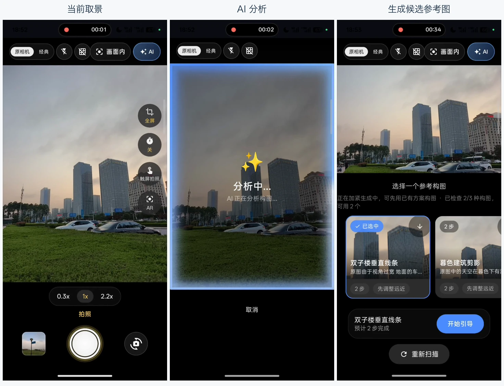
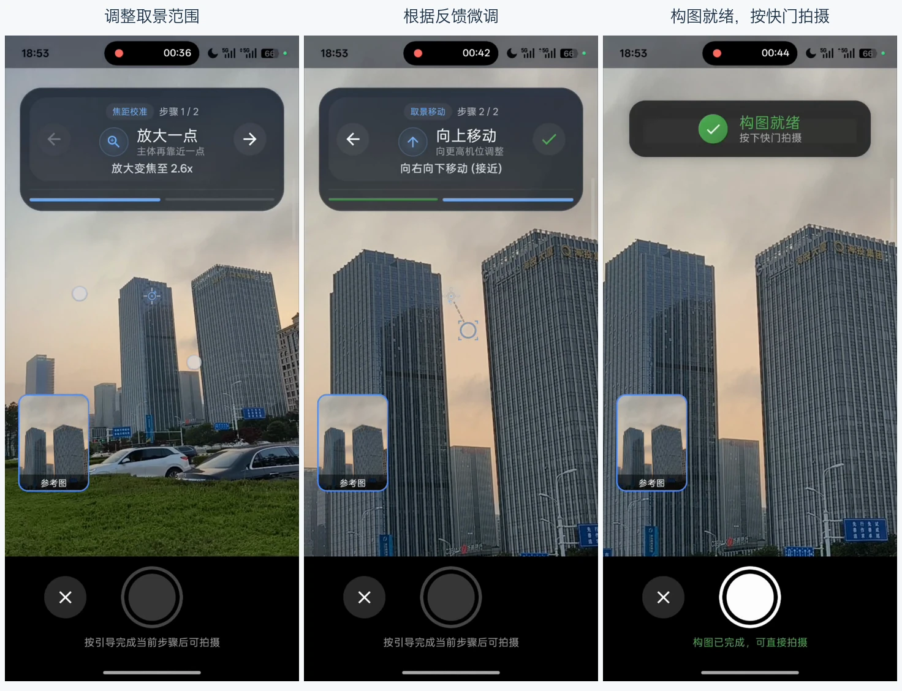
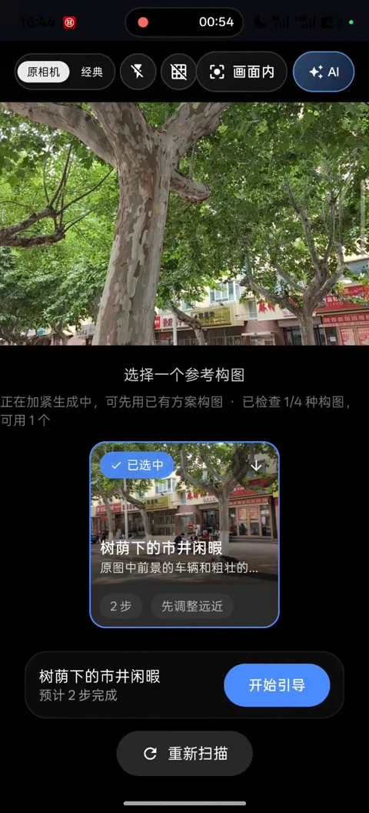
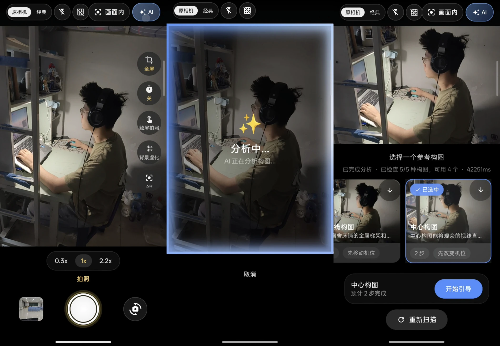
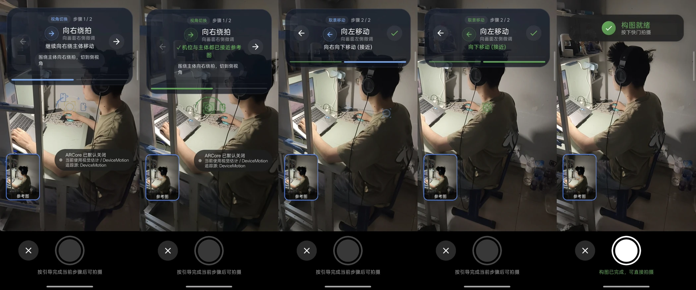
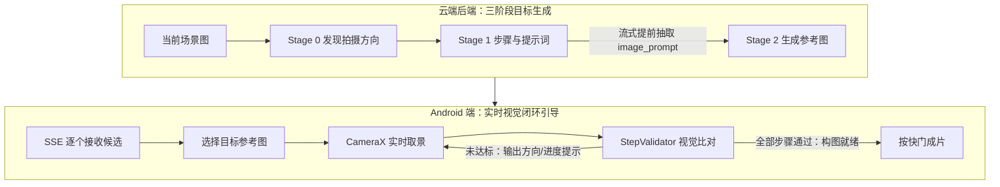

# Composition Assistant（摄影助手）

Composition Assistant 是一个面向真实拍摄场景的摄影辅助系统。系统通过手机端拍摄当前取景，由后端发现可行的摄影机会、给出调整步骤与参考图，再由客户端基于实时视觉反馈引导用户逐步调整机位与构图，直至完成拍摄。

<!--
演示素材
shooting-analysis.webp / shooting-guidance.webp / shooting-demo.mp4
  VID_20260709_185349_1.mp4，截图 1.1 / 2.6 / 5.0 / 7.2 / 12.6 / 14.5 秒，视频节选 0.55–16.85 秒。
ai-street-candidates.webp
  Record_2026-07-09-16-43-41_923ca814f8eb31202b14be11a643922f.mp4，54.4 秒。
early-ai-analysis.webp / early-ai-guidance.webp
  IMG_20260528_112023.jpg / IMG_20260528_112858.jpg。
-->

## 拍摄流程与演示

**取景 → 分析摄影机会 → 选择参考图 → 跟随实时引导 → 拍摄照片**

1. **取景并发起分析**：对准当前场景，点击右上角 `AI` 入口并拍摄/上传当前取景图。
2. **获取拍摄方案**：后端识别现场可行的拍摄方向，生成中文动作建议、生图提示词与目标参考图，并通过流式接口逐个返回。
3. **选择目标画面**：浏览候选参考图与调整思路，选中满意的方案后点击“开始引导”。
4. **调整手机与机位**：根据界面提示进行平移、绕拍、升降、水平校正或缩放；客户端持续比对当前实时画面与目标构图，实时更新步骤进度。
5. **完成拍摄**：所有步骤验证通过后界面提示“构图就绪”，按下快门保存最终成片，也可返回重新尝试其他方案。

### 从当前取景到候选参考图



### 从机位调整到构图就绪



> 以上截图来自建筑场景真机录屏，展示了“双子楼垂直线条”等场景化 AI 候选，以及参考图预览、步骤进度与“构图就绪”状态（录屏未附带当时的后端配置，提示词版本以实际运行配置为准）。

[观看建筑场景拍摄演示](./assets/readme/shooting-demo.mp4)

<details>
<summary>查看街景 AI 候选与早期固定构图演示</summary>

街景录屏中，AI 会结合现场元素生成“树荫下的市井闲暇”等具体拍摄方向：



早期 AI 流程围绕中心构图、引导线等固定技巧生成参考图，并支持绕拍和实时步骤验证：





</details>

### 两种构图入口：AI 构图 vs 画面内构图

| 入口 | 目标画面来源 | 引导与验证方式 |
| --- | --- | --- |
| **AI** | 三阶段后端分析现场，生成拍摄建议与目标参考图 | 支持平移、缩放、水平校正、升降与绕拍等多类动作的逐步视觉验证 |
| **画面内** | 外部裁切服务对原图推荐最佳裁切区域 | 由 [InFrameCompositionGuideBuilder.kt](./android_frontend/app/src/main/java/com/compositionassistant/inframe/InFrameCompositionGuideBuilder.kt) 在本地计算中心偏移与缩放倍率，生成平移/缩放引导步骤 |

---

## 系统架构与核心原理

系统采用 **“云端生成目标构图 + 端侧视觉闭环实时引导”** 的双端协同架构：



### 1. 后端：三阶段流水线生成拍摄方案

后端位于 `backend/`，默认开启的 **摄影眼模式** 会从**光影机会、反射机会、前景框景、空间层次、主体提取、几何秩序、视角重构、材质局部、瞬间叙事**九类机会中，筛选当前画面内有真实可见依据的方向：

| 阶段 | 核心职责 | 主要产出 |
| --- | --- | --- |
| **Stage 0** | 观察原始场景，预筛或发现可行拍摄方向 | 真实可见依据（`visual_evidence`）与拍摄意图（`shooting_intent`） |
| **Stage 1** | 围绕每个方向规划动作路径与生图指令 | 中文动作建议（`steps`）、弱几何先验（`shot_spec`）、英文 `image_prompt` |
| **Stage 2** | 结合原图与 `image_prompt` 生成忠于现场的目标画面 | 候选参考图（`image_base64`） |

- **低延迟流式链路**：Stage 1 在流式输出过程中尽早提取 `image_prompt`，无需等整段分析结束即可提前拉起 Stage 2；结果经过去重与多样化筛选后，通过 `/composition_analyze_stream`（SSE）逐个推送给客户端。
- **多 Provider 可插拔**：Stage 0 / Stage 1 支持在 `gemini` 与 `qwen` 间切换，Stage 2 支持 `gemini`、`qwen` 与 `openrouter`，所有模型与阶段组合均在 [`backend/config.py`](./backend/config.py) 中集中配置。

### 2. Android 端：实时视觉闭环引导

Android 端位于 `android_frontend/`，正式相机管线由 **CameraX** 驱动，不依赖云端持续推理即可在端侧完成高帧率闭环验证：

- **常规构图验证链（平移 / 缩放 / 水平校正）**：[`StepValidator.kt`](./android_frontend/app/src/main/java/com/compositionassistant/vision/StepValidator.kt) 将实时预览帧与目标参考图统一缩放到 360px 基准宽度后，利用 [`FeatureMatcher.kt`](./android_frontend/app/src/main/java/com/compositionassistant/vision/FeatureMatcher.kt)（ORB 特征匹配）与 [`HomographyAnalyzer.kt`](./android_frontend/app/src/main/java/com/compositionassistant/vision/HomographyAnalyzer.kt)（单应矩阵分解）计算平移像素差、缩放倍率与滚转角，并在特征稀疏时由 [`PerceptualHashMatcher.kt`](./android_frontend/app/src/main/java/com/compositionassistant/vision/PerceptualHashMatcher.kt)（pHash）做相似度兜底。
- **机位视角变化验证（绕拍 / 升降 / 前后移动）**：[`ViewChangeAnalyzer.kt`](./android_frontend/app/src/main/java/com/compositionassistant/vision/ViewChangeAnalyzer.kt) 融合全局特征、透视变化与 ML Kit 主体检测追踪。

---

## 提示词工程与演进

后端采用 **Prompt 资产化**设计，所有提示词集中在 `backend/prompts/<PROMPT_SET>/`，通过修改 [`backend/config.py`](./backend/config.py) 中的 `PROMPT_SET` 即可整体切换（当前默认值为 `"photographer_eye"`）。

| 提示词集 | 演进定位 | Stage 0 原文 | Stage 1 原文 |
| --- | --- | --- | --- |
| `default_v1` | **基线版**：围绕 5 种固定构图技巧，严格约束真实性与可执行单步动作 | [技巧预筛](./backend/prompts/default_v1/stage0_soft_prefilter.md) | [构图分析与步骤生成](./backend/prompts/default_v1/stage1_system_instruction.md) |
| `default_v2` | **语义增强版**：放宽适用性召回，细化机位 / 取景 / 主体放置三层动作决策 | [高召回预筛](./backend/prompts/default_v2/stage0_soft_prefilter.md) | [动作决策与输出约束](./backend/prompts/default_v2/stage1_system_instruction.md) |
| `environment_understand` | **环境推断版**：先诊断画面问题，再有限外扩推断周边 30% 环境来设计机位 | [构图技巧挑选](./backend/prompts/environment_understand/stage0_soft_prefilter.md) | [环境理解与机位指导](./backend/prompts/environment_understand/stage1_system_instruction.md) |
| `photographer_eye` | **默认主线**：摆脱固定构图教条，从现场发现 9 类摄影机会并动态生成任务 | [拍摄方向发现](./backend/prompts/photographer_eye/stage0_soft_prefilter.md) | [摄影眼分析](./backend/prompts/photographer_eye/stage1_system_instruction.md) |

<details>
<summary>展开查看四套提示词的核心设计规则</summary>

- **`default_v1`（固定技巧与真实性约束）**：Stage 0 从 5 种固定技巧中筛选有真实依据的候选；Stage 1 严禁虚构主体、移动物体或改变光照/天气，每步仅允许一个主动作，默认 1 步（必要时 2–3 步）。
- **`default_v2`（细化动作语义与适用性筛选）**：Stage 0 在证据偏弱但仍可成立时保留候选；Stage 1 细化了 `Shift` 的移动方向、`Step` 与 `Zoom` 的语义区分，以及多步方案中主体目标坐标的填写规则。
- **`environment_understand`（画面诊断与周边环境推断）**：引导模型先诊断取景缺陷，并在原图周边各方向外扩约 30% 的合理空间范围内推断周围环境（保持元素空间关系一致），给出 2 步（必要时 3–4 步）机位调整方案。
- **`photographer_eye`（当前默认摄影机会发现）**：Stage 0 要求每个方向给出原图可见的 `visual_evidence` 与摄影意图 `shooting_intent`，避免同一画面的轻微缩放重复；运行时由 [`photographer_eye_tasks.py`](./backend/services/photographer_eye_tasks.py) 动态拼装任务，Stage 1 输出 1–4 步带视觉停止条件的动作（如“直到门框把远处建筑圈住”）及 40–90 词英文 `image_prompt`。

</details>

<details>
<summary>展开查看 5 种固定构图技巧原文与 Stage 2 Provider 适配规则</summary>

### 固定构图技巧用户提示词

前三套提示词使用下表中的固定技巧用户提示词；`photographer_eye/techniques/` 仅用于保持目录加载接口兼容，主流程使用动态拍摄方向任务。

| 技巧 | default_v1 | default_v2 | environment_understand | photographer_eye 兼容文件 |
| --- | --- | --- | --- | --- |
| 三分构图 | [原文](./backend/prompts/default_v1/techniques/rule_of_thirds.md) | [原文](./backend/prompts/default_v2/techniques/rule_of_thirds.md) | [原文](./backend/prompts/environment_understand/techniques/rule_of_thirds.md) | [说明](./backend/prompts/photographer_eye/techniques/rule_of_thirds.md) |
| 中心构图 | [原文](./backend/prompts/default_v1/techniques/center_composition.md) | [原文](./backend/prompts/default_v2/techniques/center_composition.md) | [原文](./backend/prompts/environment_understand/techniques/center_composition.md) | [说明](./backend/prompts/photographer_eye/techniques/center_composition.md) |
| 引导线构图 | [原文](./backend/prompts/default_v1/techniques/leading_lines.md) | [原文](./backend/prompts/default_v2/techniques/leading_lines.md) | [原文](./backend/prompts/environment_understand/techniques/leading_lines.md) | [说明](./backend/prompts/photographer_eye/techniques/leading_lines.md) |
| 前景框景 | [原文](./backend/prompts/default_v1/techniques/foreground_framing.md) | [原文](./backend/prompts/default_v2/techniques/foreground_framing.md) | [原文](./backend/prompts/environment_understand/techniques/foreground_framing.md) | [说明](./backend/prompts/photographer_eye/techniques/foreground_framing.md) |
| 对角线构图 | [原文](./backend/prompts/default_v1/techniques/diagonal_composition.md) | [原文](./backend/prompts/default_v2/techniques/diagonal_composition.md) | [原文](./backend/prompts/environment_understand/techniques/diagonal_composition.md) | [说明](./backend/prompts/photographer_eye/techniques/diagonal_composition.md) |

### Stage 2 参考图生成适配

Stage 1 动态生成的 `image_prompt` 会与原图一起传给 Stage 2，[`prompt_adapters.py`](./backend/services/prompt_adapters.py) 会按不同 Provider 补充真实性约束：

| Provider | 适配规则 | 实现文件 |
| --- | --- | --- |
| **Gemini** | 保留主体身份、场景布局、光照逻辑与材质，限定通过相机移动、裁切或缩放调整构图 | [stage2_gemini_provider.py](./backend/services/stage2_gemini_provider.py) |
| **Qwen** | 保留主体与环境，限定相机取景变化，强调真实、自然的摄影效果 | [stage2_qwen_provider.py](./backend/services/stage2_qwen_provider.py) |
| **OpenRouter** | 直接使用 Stage 1 生成的 `image_prompt` 请求图像生成接口 | [stage2_openrouter_provider.py](./backend/services/stage2_openrouter_provider.py) |

</details>

---

## 项目结构、交付范围与技术栈

### 标准交付目录

```text
Composition_Assistant_V1
├── android_frontend       # Android 客户端（Kotlin + Jetpack Compose + CameraX + OpenCV）
├── backend                # 三阶段 AI 后端主干（Python + FastAPI + SSE）
├── assets                 # 文档展示素材（真机演示截图与视频）
├── API_access_tests       # 模型与接口实验验证脚本
├── test_images            # 平移 / 缩放 / 视角变化测试样本图
├── gemini_enterprise.py   # Gemini Enterprise Agent Platform 客户端初始化辅助（供测试脚本复用）
└── .env.example           # 环境变量模板
```

> 说明：`Gemini_prompt_tests` 目录包含早期大规模 Prompt 实验记录与生成图片，体积较大且**不是**前后端运行的依赖项，已从标准交付范围移出并单独归档。

### 技术栈概览

| 端侧 | 核心技术与依赖 |
| --- | --- |
| **Android 端** | Kotlin + Jetpack Compose、CameraX、Lifecycle + ViewModel + StateFlow、Retrofit + OkHttp、OpenCV 4.12、ML Kit Object Detection |
| **后端** | Python 3.10+ + FastAPI、Pydantic、`google-genai`（Enterprise Agent Platform v1）、DashScope / OpenAI-compatible client、Pillow、SSE（`StreamingResponse`） |

---

## 快速开始

### 1. 启动三阶段后端

详细配置说明与接口文档请查看 [backend/README.md](./backend/README.md)。

```bash
cd backend
pip install -r requirements.txt
```

在仓库根目录根据 [`.env.example`](./.env.example) 创建 `.env` 并注入当前 shell，或直接导出环境变量：

```bash
cp .env.example .env
set -a && source .env && set +a
# 或直接 export：
export GOOGLE_CLOUD_PROJECT=picgen-503700
export GOOGLE_API_KEY=replace-with-agent-platform-api-key
```

> 注意：`GOOGLE_API_KEY` 须是在目标 Google Cloud 项目中创建的标准 API Key。官方 Gemini 调用走 Enterprise Agent Platform v1，`GOOGLE_CLOUD_PROJECT` 仅用于本地校验和日志，不会直接传入 SDK Client。如需切换 Qwen、OpenRouter、代理或混合 Provider，请修改 [`backend/config.py`](./backend/config.py) 中的 `STAGE0_PROVIDER`、`STAGE1_PROVIDER`、`STAGE2_PROVIDER`、`USE_GEMINI_PROXY` 及 `USE_GEMINI_DOMESTIC_API`。

启动后端服务：

```bash
cd backend
uvicorn main:app --host 0.0.0.0 --port 8100 --reload
```

启动后可访问交互式文档与健康检查接口：
- `http://localhost:8100/docs`
- `http://localhost:8100/health`

### 2. 配置并运行 Android 客户端

详细架构与本地开发说明请查看 [android_frontend/README.md](./android_frontend/README.md)。

客户端接口地址配置位于 [`ApiConfig.kt`](./android_frontend/app/src/main/java/com/compositionassistant/data/api/ApiConfig.kt)，默认配置指向已部署的服务地址：
- `AI_COMPOSITION_URL`：`http://aicrop.312237.xyz/`
- `IN_FRAME_COMPOSITION_URL`：`https://crop2.312237.xyz/predict?return_preview=0`

如需连接本地启动的后端进行联调，请修改 `AI_COMPOSITION_URL`（注意保留结尾 `/`）：

```kotlin
// Android 模拟器访问宿主机本地后端
const val AI_COMPOSITION_URL = "http://10.0.2.2:8100/"

// 真机通过同一局域网访问电脑后端（替换为实际局域网 IP）
const val AI_COMPOSITION_URL = "http://192.168.1.20:8100/"
```

然后使用 Android Studio 打开 `android_frontend` 目录，等待 Gradle Sync 完成后连接真机或模拟器点击 **Run** 即可。

---

## 代码导读与关键事实

### 推荐阅读顺序

1. 本仓库总览（本文档）
2. Android 客户端架构：[android_frontend/README.md](./android_frontend/README.md)
3. 后端流水线说明：[backend/README.md](./backend/README.md)
4. 前端相机入口与业务状态机：[`CameraScreen.kt`](./android_frontend/app/src/main/java/com/compositionassistant/ui/screens/CameraScreen.kt) → [`CameraViewModel.kt`](./android_frontend/app/src/main/java/com/compositionassistant/viewmodel/CameraViewModel.kt)
5. 端侧视觉闭环核心：[`StepValidator.kt`](./android_frontend/app/src/main/java/com/compositionassistant/vision/StepValidator.kt)
6. 后端路由与编排核心：[`backend/routers/composition.py`](./backend/routers/composition.py) → [`backend/services/common.py`](./backend/services/common.py)

### 关键事实与注意事项

- **摄影眼模式强依赖 Stage 0**：在默认 `"photographer_eye"` 模式下，`ENABLE_STAGE0 = True` 负责生成运行时拍摄方向任务；关闭它不会自动回退到固定构图技巧，会导致无候选方案产出。
- **流式优先与回退机制**：Android 客户端优先请求 `/composition_analyze_stream` 逐个接收候选方案，流式失败时自动回退至 `/composition_analyze`。
- **实时引导基线边界**：本仓库正式相机链路以 `CameraX` + 视觉匹配和图像几何分析为基础。
- **外部裁切服务**：画面内构图模式依赖 `IN_FRAME_COMPOSITION_URL` 指向的外部裁切服务，不在本仓库代码内。
- **配置方式**：敏感 API Key 从环境变量读取，其余 Provider、模型、超时、代理与提示词集均直接在 [`backend/config.py`](./backend/config.py) 中维护。
- **冗余依赖说明**：Android 端虽然声明了 Coil 依赖，但当前核心候选参考图与界面图片渲染并不依赖它。
