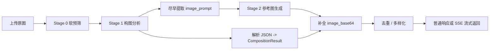

# PhotoFramer Backend - Three-Stage Pipeline

`backend` 是当前 PhotoFramer 的后端主干。它的实际运行架构是三阶段流水线：

- Stage 0：候选构图技术软预筛；在摄影眼模式下选择拍摄方向并生成运行时任务
- Stage 1：构图分析、步骤生成与 `image_prompt` 产出
- Stage 2：参考构图图生成

这套后端的目标不是做最终拍摄验证，而是为前端持续产出“值得尝试的目标构图方案”。

## 这套后端做什么

输入是一张当前场景图，输出是若干个 `CompositionResult`。每个候选里通常包含：

- `technique`
- `technique_name`
- `aesthetic_desc`
- `steps`
- `shot_spec`
- `image_prompt`
- `image_base64`
- `timing`

也就是说，后端输出的不只是“这张图适合三分构图”，而是：

- 适不适合
- 为什么适合
- 用户该怎么挪手机
- 目标画面大致长什么样

## 架构概览



## 当前候选任务

当前 `config.py` 使用 `PROMPT_SET = "photographer_eye"`。Stage 0 会根据画面从摄影方向中选择可行机会，再将其转换为运行时 Stage 1 任务；返回字段仍沿用 `technique` / `technique_name`，以保持前端协议兼容。

固定构图 technique 列表仍作为兼容资产加载：

- `rule_of_thirds`
- `center_composition`
- `leading_lines`
- `foreground_framing`
- `diagonal_composition`

## Provider 组合方式

每个阶段都可以单独切换 provider：

- Stage 0：`gemini` / `qwen`
- Stage 1：`gemini` / `qwen`
- Stage 2：`gemini` / `qwen` / `openrouter`

因此可以自由组合，例如：

- `gemini -> gemini -> gemini`
- `gemini -> gemini -> qwen`
- `qwen -> qwen -> gemini`
- `qwen -> gemini -> gemini`
- `gemini -> gemini -> openrouter`

当前 `config.py` 默认使用 Gemini 组合：

- `STAGE1_PROVIDER = "gemini"`
- `STAGE2_PROVIDER = "gemini"`
- `STAGE0_PROVIDER = STAGE1_PROVIDER`

Stage 0 当前默认开启（`ENABLE_STAGE0 = True`）。摄影眼模式依赖它生成运行时方向任务；关闭后不会回退到固定构图 technique。

## 目录结构

```text
backend
├── main.py
├── config.py
├── requirements.txt
├── routers
│   ├── composition.py
│   └── image.py
├── schemas
│   ├── composition.py
│   └── image.py
├── services
│   ├── __init__.py
│   ├── common.py
│   ├── stage0_gemini_provider.py
│   ├── stage0_qwen_provider.py
│   ├── stage1_gemini_provider.py
│   ├── stage1_qwen_provider.py
│   ├── stage2_gemini_provider.py
│   ├── stage2_openrouter_provider.py
│   ├── stage2_qwen_provider.py
│   ├── gemini_client_factory.py
│   ├── gemini_profiles.py
│   ├── photographer_eye_tasks.py
│   └── prompt_adapters.py
├── prompts
│   ├── photographer_eye             # 当前运行集，创意能力较强，但是不好引导成功
│   │   ├── stage0_soft_prefilter.md
│   │   ├── stage1_system_instruction.md
│   │   └── techniques
│   ├── default_v1                   # 备用/创意性一般，相对原图的改善较少，引导成功率高一些
│   ├── default_v2                   # 备用/比v1创意性好一些
│   └── environment_understand       # 备用/引入思维链，让模型脑补周围环境之后再去进行构图
└── tests
    └── test_pipeline_guards.py
```

## 关键设计点

### 1. Prompt 资产化

提示词不写死在 provider 里，而是放在 `prompts/<提示词集>/` 下。当前运行集为：

- `prompts/photographer_eye/stage1_system_instruction.md`
- `prompts/photographer_eye/stage0_soft_prefilter.md`
- `prompts/photographer_eye/techniques/*.md`

这样做的好处是：

- 更方便调 prompt
- 更方便记录实验
- 更适合做论文/答辩里的方法说明

当前运行时通过 `config.py` 中硬编码的 `PROMPT_SET` 选择一整套 prompt 资产：

```python
PROMPT_SET = "photographer_eye"
```

三类 prompt 路径会由 `PROMPT_SET` 自动派生：

```python
STAGE1_SYSTEM_PROMPT_PATH = f"{PROMPT_SET}/stage1_system_instruction.md"
STAGE0_SOFT_PREFILTER_PROMPT_PATH = f"{PROMPT_SET}/stage0_soft_prefilter.md"
TECHNIQUE_PROMPT_DIR = f"{PROMPT_SET}/techniques"
```

如需试验另一套 prompt 组合，直接修改 `config.py` 中的 `PROMPT_SET`；不支持通过环境变量覆盖。

摄影眼模式下，固定 technique 提示词仅为路径与协议兼容资产。实际 Stage 1 使用的是 Stage 0 根据画面生成的运行时拍摄方向任务。

### 2. 流式 prompt 前置

当前 Gemini 和 Qwen 的 Stage 1 都支持在流式输出中尽早抽取 `image_prompt`。这意味着：

- 不需要等 Stage 1 全部结束
- 只要 `image_prompt` 出来了
- Stage 2 就可以提前启动

这是这套后端降低总时延的关键优化之一。

### 3. Provider 适配层

不同模型的调用细节被封装在 provider 层：

- Qwen 文本阶段用 OpenAI-compatible client
- Qwen 图像阶段用 DashScope
- Gemini 用 `google-genai`
- OpenRouter 仅用于 Stage 2，通过 Images API 生成参考图

路由层不直接关心这些差异，只通过 `get_stage0_service()`、`get_stage1_service()`、`get_stage2_service()` 取服务实例。

### 4. 输出契约统一

不同 provider 返回的格式并不完全一样，但最后都会被收敛成统一的 schema：

- `AnalysisResponse`
- `CompositionResult`
- `ImageGenerationResponse`

前端只需要理解统一格式，不需要知道当前后端跑的是 Qwen 还是 Gemini。

## 运行环境要求

- Python 3.10+
- 可访问相应模型服务的网络环境
- 如使用官方 Gemini，可能需要代理

## 安装

```bash
cd backend
pip install -r requirements.txt
```

依赖包括：

- `fastapi`
- `uvicorn[standard]`
- `python-multipart`
- `openai`
- `pillow`
- `python-dotenv`
- `dashscope`
- `google-genai`

注意：

- 当前只从环境变量读取 API key；provider、模型、代理、超时等配置请直接修改 `config.py`
- 代码没有自动调用 `load_dotenv()`，因此 API key 请直接在 shell 中 `export`，或者由你的运行器负责注入

## 最小可运行配置

### 方案一：默认 Gemini 配置

当前 `config.py` 默认使用 Gemini provider，最少需要：

```bash
export GEMINI_API_KEY=your_gemini_key （服务器上有）
```

如果使用官方 Gemini，服务器上的代理相关配置为：

- `USE_GEMINI_PROXY = True`
- `GEMINI_PROXY_URL = "http://127.0.0.1:11087"`

如果不需要代理，请在 `config.py` 中把 `USE_GEMINI_PROXY` 改为 `False`。

### 方案二：Qwen （API额度已耗尽）
先在 `config.py` 中切换 provider，例如：

```python
STAGE0_PROVIDER = "qwen"
STAGE1_PROVIDER = "qwen"
STAGE2_PROVIDER = "qwen"
```

然后注入 key：

```bash
export DASHSCOPE_API_KEY=your_dashscope_key （服务器上有，但是额度不足）
```

### 方案三：国内 Gemini 兼容中转

先在 `config.py` 中开启：

```python
USE_GEMINI_DOMESTIC_API = True
GEMINI_DOMESTIC_BASE_URL = "https://your-proxy-root.example.com"
GEMINI_DOMESTIC_API_VERSION = "v1beta"
```

然后注入 key：

```bash
export GEMINI_DOMESTIC_API_KEY=your_key
```

注意：

- `GEMINI_DOMESTIC_BASE_URL` 填服务根地址或 API 根地址
- 不要填到某个完整 `generateContent` 路径

### 方案四：Gemini 分析 + OpenRouter 生图

OpenRouter 当前只支持 Stage 2。保留 Gemini 负责 Stage 0 / Stage 1，将 Stage 2 切换为 OpenRouter：

```python
STAGE0_PROVIDER = "gemini"
STAGE1_PROVIDER = "gemini"
STAGE2_PROVIDER = "openrouter"
```

然后注入两个服务所需的 key：

```bash
export GEMINI_API_KEY=your_gemini_key
export OPENROUTER_API_KEY=your_openrouter_key （服务器上有）
```

当前 OpenRouter Stage 2 默认模型是：

```python
OPENROUTER_STAGE2_MODEL = "google/gemini-3.1-flash-lite-image"
```

网络配置默认复用 `GEMINI_PROXY_URL`。若 OpenRouter 不需要代理，将 `USE_OPENROUTER_PROXY` 改为 `False`；若需单独指定代理，可通过 `OPENROUTER_PROXY_URL` 环境变量覆盖。服务启动时会输出 OpenRouter 代理连通性自检结果。

注意：当前模型实现固定单张、非流式 1K 生成；可通过 `OPENROUTER_STAGE2_RESOLUTION` 和 `OPENROUTER_STAGE2_ASPECT_RATIO` 调整请求参数，但应以所选模型实际支持的能力为准。

### 方案五：其他混合 Provider

先在 `config.py` 中切换 provider，例如：

```python
STAGE0_PROVIDER = "qwen"
STAGE1_PROVIDER = "qwen"
STAGE2_PROVIDER = "gemini"
```

然后注入对应 key：

```bash
export DASHSCOPE_API_KEY=your_dashscope_key
export GEMINI_API_KEY=your_gemini_key
```

## 常用配置

常用配置集中在 `config.py`：

- Provider：`STAGE0_PROVIDER`、`STAGE1_PROVIDER`、`STAGE2_PROVIDER`
- Prompt set：`PROMPT_SET`（直接修改 `config.py`，不使用环境变量）
- 模型：`QWEN_STAGE*_MODEL`、`GEMINI_STAGE*_MODEL`
- Stage 0：`ENABLE_STAGE0`、`STAGE0_MAX_TECHNIQUES`、`STAGE0_TEMPERATURE`、`STAGE0_TOP_P`
- 吞吐与超时：`STAGE1_MAX_CONCURRENCY`、`STAGE1_TIMEOUT_SECONDS`、`STAGE2_TIMEOUT_SECONDS`
- 采样参数：`MODEL_TEMPERATURE`、`MODEL_TOP_P`、`MODEL_TOP_K`、`MODEL_MAX_TOKENS`
- Gemini 代理 / 中转：`USE_GEMINI_PROXY`、`GEMINI_PROXY_URL`、`USE_GEMINI_DOMESTIC_API`
- OpenRouter Stage 2：`OPENROUTER_STAGE2_MODEL`、`USE_OPENROUTER_PROXY`、`OPENROUTER_PROXY_URL`
- Qwen 图像侧限速：`IMAGE_MAX_RATE`

环境变量仅用于注入敏感 key：

```bash
export GEMINI_API_KEY=your_gemini_key
export GEMINI_DOMESTIC_API_KEY=your_domestic_key
export DASHSCOPE_API_KEY=your_dashscope_key
export OPENROUTER_API_KEY=your_openrouter_key
```

## 运行

### 开发模式

```bash
uvicorn main:app --host 0.0.0.0 --port 8100 --reload
```

### 直接运行

```bash
python main.py
```

启动后默认文档地址：

- `http://localhost:8100/docs`
- `http://localhost:8100/redoc`

## 接口列表

### `GET /`

返回当前服务版本、stage provider / model 和 technique 列表。

### `POST /composition_analyze`

普通非流式三阶段入口。

请求：

- `multipart/form-data`
- 字段名：`image`

响应：

- `AnalysisResponse`

### `POST /composition_analyze_stream`

SSE 流式入口，适合前端逐个接收候选结果。

流式事件包括：

- `analysis_started`
- `candidate_ready`
- `technique_skipped`
- `candidate_duplicate_skipped`
- `summary`
- `[DONE]`

### `POST /image_generate`

仅调用当前 `STAGE2_PROVIDER` 做图像生成。

### `GET /health`

健康检查接口，返回当前模型与 technique 列表。

## 示例请求

### 普通分析

```bash
curl -X POST \
  -F "image=@../test_images/sample.jpg" \
  http://127.0.0.1:8100/composition_analyze
```

### 流式分析

```bash
curl -N -X POST \
  -F "image=@../test_images/sample.jpg" \
  http://127.0.0.1:8100/composition_analyze_stream
```

### 仅调用 Stage 2

```bash
curl -X POST http://127.0.0.1:8100/image_generate \
  -H "Content-Type: application/json" \
  -d '{
    "requests": [
      {
        "technique_id": "rule_of_thirds",
        "image_prompt": "Reframe the scene using rule of thirds.",
        "original_image_b64": null
      }
    ]
  }'
```

## 响应特点

返回的 `compositions[]` 统一包含：

- `steps`
- `shot_spec`
- `image_prompt`
- `image_base64`
- `timing`

这就是 Android 前端可以不关心具体 provider 差异的原因。

## 运行时特性

### 1. 上传大小限制

当前最大上传大小约为：

- 12 MB

### 2. 候选去重与多样化

路由层会根据：

- steps 签名
- viewpoint 需求
- 主体中心
- 主体大小
- technique 本身

做近重复判断，避免前端收到一堆非常相似的候选。

### 3. Gemini 模型能力适配

`gemini_profiles.py` 会根据不同 Gemini 模型决定是否下发：

- `top_k`
- `max_output_tokens`
- `image_config`
- `image_size`
- `thinking_config`

这是为了减少不同模型族之间的参数不兼容问题。

## 测试

运行当前可见测试：

```bash
pytest tests/test_pipeline_guards.py
```

## 常见问题

### 1. 为什么明明设置了 `.env`，服务还是读不到 key

因为当前代码没有自动调用 `load_dotenv()`。请直接在 shell 中 `export` API key，或用你的进程管理器注入。

### 2. 为什么官方 Gemini 启动时报代理问题

因为 `USE_GEMINI_PROXY` 当前默认值是 `True`。如果你不需要代理，请在 `config.py` 中把它改为 `False`。

### 3. 摄影眼模式下为什么必须保留 Stage 0

当前默认：

```python
ENABLE_STAGE0 = True
```

摄影眼模式中，Stage 0 不只是预筛，还会根据画面生成拍摄方向并创建运行时 Stage 1 任务。若关闭它，后端不会回退到固定构图 technique，因此不会产生候选方案。

### 4. 为什么前端默认地址和本地端口对不上

因为 Android 前端默认指向的是现有公网部署地址，而本地开发默认端口是：

- `8100`

联调时需要手动改前端 `ApiConfig.kt`。

## 相关文档

- 仓库总说明：[../README.md](../README.md)
- Android 前端说明：[../android_frontend/README.md](../android_frontend/README.md)
